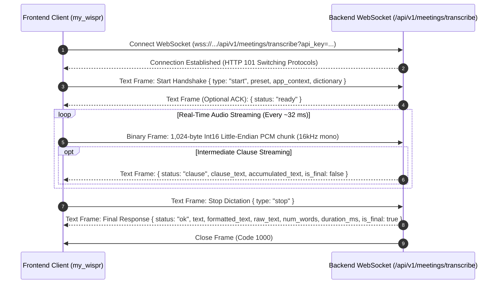
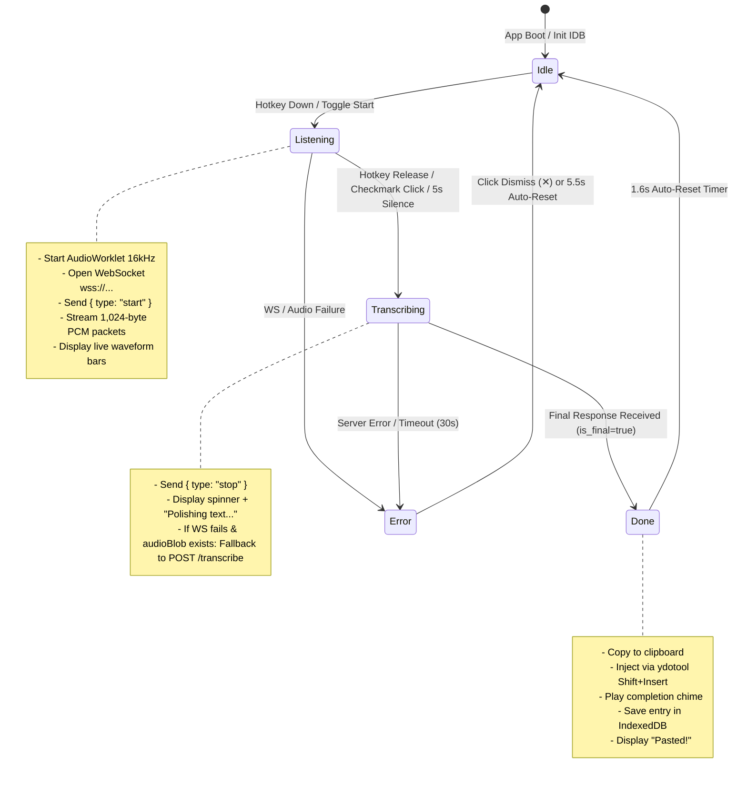

# Wispr Flow Linux — Backend Communication Contract & Protocol Specification

This specification documents the complete communication contract expected from the backend server by the `my_wispr` frontend client. It covers the active live server credentials, real-time WebSocket audio streaming, incoming server message schemas, the Re-transcribe action, and auxiliary REST endpoints.

---

## 0. Confirmed Live Dedicated Server Credentials & Connection Settings

The dedicated backend server is verified live on our cloud VM. It runs a unified Layer 1 NVIDIA Parakeet 0.6B INT8 ASR + Layer 2 native C++ Qwen 2.5 3B Q4_K_M cleanup pipeline.

* **Base Server URL**: `https://8000-agq75oq6i7eazd5pahfhehvvj4.instabox.tech`
* **Real-Time WebSocket Endpoint**: `wss://8000-agq75oq6i7eazd5pahfhehvvj4.instabox.tech/api/v1/meetings/transcribe`
* **Health Check REST Endpoint**: `GET https://8000-agq75oq6i7eazd5pahfhehvvj4.instabox.tech/health`
* **Batch / Re-transcribe REST Endpoint**: `POST https://8000-agq75oq6i7eazd5pahfhehvvj4.instabox.tech/transcribe`
* **Environment Variable**: `VITE_FLOW_API_URL="https://8000-agq75oq6i7eazd5pahfhehvvj4.instabox.tech"`
* **Intermediate Clause Streaming**: Enabled (Emits `{ status: "clause", clause_index, clause_text, accumulated_text, is_final: false }` during natural pauses, resolved by final `{ status: "ok", is_final: true }`).
* **Audio Retention Policy**: Stateless server; audio cached locally in IndexedDB (`flow-dictation-db`).
* **Local Self-Hosted LLM Fallback (Optional)**: Point to `http://192.168.1.126:11434/v1` (Ollama/LM Studio) for local Layer 2 cleanup if selected in Settings.

---

## 1. Real-Time Audio Streaming (WebSocket)

### 1.1 Connection & Endpoint Derivation
* **Client Implementation**: [`src/services/api.ts`](file:///home/nmashokkumar/Workspace/Projects/wisprflow/my_wispr/src/services/api.ts) (`StreamingDictationSession`) and [`src/utils/pcmAudio.ts`](file:///home/nmashokkumar/Workspace/Projects/wisprflow/my_wispr/src/utils/pcmAudio.ts) (`deriveWebSocketUrl`).
* **Base URL Translation**:
  * An HTTP/HTTPS Base URL configured in Settings (e.g. `https://api.myflow.internal` or `http://127.0.0.1:8000`) is transformed via `deriveWebSocketUrl()`:
    * `http://host:port` ➔ `ws://host:port/api/v1/meetings/transcribe`
    * `https://host:port` ➔ `wss://host:port/api/v1/meetings/transcribe`
* **Query Parameters (Authentication)**:
  * When an API key is configured, it is appended as a query parameter:
    `wss://host:port/api/v1/meetings/transcribe?api_key=<API_KEY>`



### 1.2 Binary Audio Packet Specification
* **Sample Rate**: `16,000 Hz` (`TARGET_SAMPLE_RATE = 16000`).
* **Channels**: `1` (Mono).
* **Format**: `16-bit signed integer (Int16)`, Little-Endian.
* **Frame Chunk Size**:
  * Samples per packet: `512` samples (`PCM_PACKET_SAMPLES = 512`).
  * Bytes per packet: `1,024` bytes (`PCM_PACKET_BYTES = 1024`).
  * Duration per packet: `32 milliseconds` ($512 / 16000 = 0.032\text{ s}$).
* **Buffer & Delivery Behavior**:
  * Audio captured via `AudioWorkletProcessor` (`flow-pcm-stream-processor`) is downsampled from the mic native rate (44.1kHz / 48kHz) to 16kHz Int16.
  * Packets are buffered up to ~12.8s (400 packets) if the WebSocket handshake is still negotiating, ensuring no initial syllables are lost.

### 1.3 Client Control Messages (Outbound Text Frames)

#### A. Handshake Message (`type: "start"`)
Immediately upon WebSocket `onopen`, the client sends this JSON payload:

```json
{
  "type": "start",
  "preset": "standard",
  "app_context": "Slack",
  "dictionary": [
    {
      "type": "word",
      "trigger": "Wispr Flow"
    },
    {
      "type": "replacement",
      "trigger": "btw",
      "replacement": "by the way"
    }
  ]
}
```

##### Field Schema
| Key | Type | Required | Description |
| :--- | :--- | :--- | :--- |
| `type` | `"start"` | Yes | Dictation session initialization command. |
| `preset` | `string` | Yes | Formatting tone preset. Options: `"standard"`, `"formal"`, `"casual"`, `"very_casual"`, or `"raw"`. Default: `"standard"`. |
| `app_context` | `string` | Yes | Target application context name (e.g. `"Slack"`, `"Gmail"`, `"VS Code"`, `"Terminal"`). |
| `dictionary` | `Array<DictionaryItem>` | Yes | Active personal dictionary entries. |

##### `DictionaryItem` Object Schema
* **Word Entry** (enforce correct spelling/capitalization):
  ```json
  { "type": "word", "trigger": "Kubernetes" }
  ```
* **Replacement Entry** (expand spoken trigger to target string):
  ```json
  { "type": "replacement", "trigger": "my email", "replacement": "alex@company.com" }
  ```

#### B. Finalize Dictation Message (`type: "stop"`)
Sent when the user releases the Push-to-Talk key, clicks the Hands-Free checkmark (`✓`), or the 5-second silence auto-stop triggers:

```json
{
  "type": "stop"
}
```

---

## 2. Server Message Events (Inbound Text Frames)

### 2.1 Intermediate Clause Updates (Optional Streaming Transcription)
When the backend ASR engine (Layer 1) identifies complete spoken clauses or VAD segments before the final cleanup:

```json
{
  "status": "clause",
  "clause_index": 1,
  "clause_text": "can you send the report",
  "accumulated_text": "can you send the report",
  "is_final": false
}
```

##### Field Schema
| Field | Type | Required | Description |
| :--- | :--- | :--- | :--- |
| `status` | `"clause"` | Yes | Identifies an intermediate partial transcription event. |
| `clause_index` | `number` | No | 1-based index of the detected clause segment. |
| `clause_text` | `string` | Yes | Verbatim text of the latest clause. |
| `accumulated_text`| `string` | Yes | Verbatim concatenation of all clauses in this session. |
| `is_final` | `false` | Yes | Explicit flag indicating dictation is still active. |

---

### 2.2 Final Response Object
Sent by the server after processing `{ "type": "stop" }` through Layer 1 ASR and Layer 2 LLM cleanup:

```json
{
  "status": "ok",
  "text": "Can you send the report to Sarah by Friday? Let her know it's nearly done.",
  "formatted_text": "Can you send the report to Sarah by Friday? Let her know it's nearly done.",
  "raw_text": "um so can you send the the report to Sarah by uh Thursday actually no Friday and let her know its nearly done",
  "num_words": 16,
  "duration_ms": 6200,
  "layer2_latency_ms": 210,
  "language": "en",
  "is_final": true
}
```

##### Field Schema & Frontend Consumption
| Field | Type | Required | How Frontend Consumes This |
| :--- | :--- | :--- | :--- |
| `status` | `"ok"` \| `"success"` | Yes | Confirms successful transcription. If `"error"`, triggers error state. |
| `formatted_text` | `string` | **Yes** | Primary polished transcript inserted into the active OS window and saved to history. |
| `text` | `string` | Fallback | Fallback for `formatted_text` if omitted. |
| `raw_text` | `string` | Recommended | Verbatim speech before LLM cleanup. Shown in the *"View raw speech"* accordion on the Dictation card. If omitted, defaults to `formatted_text`. |
| `num_words` | `number` | Optional | Word count. If omitted, frontend auto-calculates via `text.split(/\s+/).length`. |
| `duration_ms` | `number` | Optional | Total duration of audio in milliseconds. Drives WPM speaking rate calculations in Insights. Fallback: recording wall-clock time. |
| `layer2_latency_ms`| `number` | Optional | LLM refinement processing time in milliseconds. |
| `language` | `string` | Optional | ISO language code (e.g. `"en"`, `"es"`). Saved with history entry. |
| `is_final` | `true` | **Yes** | Signals the client that the dictation session has resolved and WebSocket can close. |

##### Error Event Payload
```json
{
  "status": "error",
  "error": "Transcription backend timed out after 30 seconds.",
  "message": "Transcription backend timed out after 30 seconds."
}
```

---

## 3. The "Re-transcribe" Action Contract

### 3.1 Overview
* **Trigger**: Click `⋮` (More Menu) ➔ `↺ Re-transcribe` on any card in the Dictation history feed.
* **Client Implementation**: [`src/store/useFlowStore.ts`](file:///home/nmashokkumar/Workspace/Projects/wisprflow/my_wispr/src/store/useFlowStore.ts) (`retranscribeHistory`) and [`src/services/api.ts`](file:///home/nmashokkumar/Workspace/Projects/wisprflow/my_wispr/src/services/api.ts) (`batchTranscribeAudio`).

### 3.2 Dual Path Execution Logic
1. **Recorded Dictations (with cached audio Blob)**:
   * The client retrieves the binary `audioBlob` stored in IndexedDB (`flow-dictation-db`).
   * If `audioBlob.size > 32`, the client issues a `POST` request to `{baseUrl}/transcribe`.
2. **Sample / Seed Entries (no binary audio cached)**:
   * Re-processed entirely on the client through `applyLocalCleanupPipeline()` using the latest dictionary rules and standard cleanup config without issuing a network request.

### 3.3 HTTP Request Specification
* **Endpoint**: `POST {baseUrl}/transcribe`
* **Content-Type**: `multipart/form-data`
* **Headers**:
  ```http
  X-API-Key: <OPTIONAL_API_KEY>
  Authorization: Bearer <OPTIONAL_API_KEY>
  Accept: application/json
  ```

#### Multipart Form Fields
| Part Name | Type | Value / Format | Example |
| :--- | :--- | :--- | :--- |
| `audio` | File / Binary | `audio/webm;codecs=opus` or `audio/wav` | Binary audio blob (filename: `retranscribe.webm`) |
| `style` | String | Style preset string | `"standard"` |
| `dictionary` | String (JSON) | JSON array of `{ type, trigger, replacement? }` | `"[{\"type\":\"word\",\"trigger\":\"Wispr Flow\"}]"` |
| `language` | String | ISO language code | `"en"` |

### 3.4 Expected Re-transcribe Response
Returns a JSON object matching the `TranscribeResponse` schema:

```json
{
  "status": "ok",
  "formatted_text": "Can you send the report to Sarah by Friday? Let her know it's nearly done.",
  "raw_text": "um so can you send the the report to Sarah by uh Thursday actually no Friday and let her know its nearly done",
  "num_words": 16,
  "duration_ms": 6200,
  "language": "en",
  "is_final": true
}
```

---

## 4. Auxiliary REST Endpoints

### 4.1 Health Check (`GET /health`)
* **Endpoint**: `GET {baseUrl}/health` (with fallback routes `/api/health`, `/v1/health`, and `GET {baseUrl}/`)
* **Headers**:
  ```http
  X-API-Key: <OPTIONAL_API_KEY>
  Authorization: Bearer <OPTIONAL_API_KEY>
  ```
* **Trigger**: Invoked when the user clicks *"Test connection"* in the Settings modal, or periodically to monitor link status.
* **Success Response Schema (`HTTP 200 OK`)**:
  ```json
  {
    "ok": true,
    "status": "ok",
    "mode": "upstream",
    "provider": "self-hosted-openai",
    "model": "whisper-1",
    "cleanupProvider": "upstream",
    "authRequired": false,
    "endpoints": {
      "flow": "/transcribe",
      "openaiCompatible": "/v1/audio/transcriptions",
      "whisperCppCompatible": "/inference"
    },
    "timestamp": "2026-11-23T11:45:00.000Z"
  }
  ```
  *(Note: A plain `{ "status": "ok" }` or empty HTTP 200 is also treated as valid by `checkServerHealth`)*.

---

### 4.2 Fallback Batch Transcription (`POST /transcribe`)
* **Endpoint**: `POST {baseUrl}/transcribe`
* **Trigger**:
  1. Triggered by **Re-transcribe**.
  2. Triggered as an **automatic fallback** if the live WebSocket stream disconnects unexpectedly while real audio was buffered in `recording.blob` ([`useFlowStore.ts:685-703`](file:///home/nmashokkumar/Workspace/Projects/wisprflow/my_wispr/src/store/useFlowStore.ts#L685-L703)).
* **Request Payload**: Identical `multipart/form-data` structure as the Re-transcribe endpoint (`audio`, `style`, `dictionary`, `language`).

---

### 4.3 Third-Party Client Compatibility Endpoints (in `server.ts`)
The built-in Express server also exposes endpoints compatible with external tools (such as OpenWhispr, OpenAI SDKs, or local CLI scripts):
1. **OpenAI Compatible Audio Endpoint**:
   * `POST /v1/audio/transcriptions` and `POST /audio/transcriptions`
   * Accepts multipart fields: `file` (or `audio`), `model`, `prompt`, `language`, `response_format` (`json` or `text`).
2. **whisper.cpp Compatible Endpoint**:
   * `POST /inference`
   * Accepts multipart fields: `file`, `temperature`, `language`, `prompt`.

---

## 5. Summary State Transition Matrix



---

## 6. Complete TypeScript Interface Definitions

```typescript
// ==========================================
// 1. WebSocket Control & Frame Types
// ==========================================

export interface WsHandshakePayload {
  type: 'start';
  preset: 'standard' | 'formal' | 'casual' | 'very_casual' | 'raw';
  app_context: string; // e.g. "Slack", "Gmail", "VS Code"
  dictionary: Array<{
    type: 'word' | 'replacement';
    trigger: string;
    replacement?: string;
  }>;
}

export interface WsStopPayload {
  type: 'stop';
}

export interface WsClauseEvent {
  status: 'clause';
  clause_index?: number;
  clause_text: string;
  accumulated_text: string;
  is_final: false;
}

export interface WsFinalResponse {
  status: 'ok' | 'success';
  text?: string;
  formatted_text: string;
  raw_text?: string;
  num_words?: number;
  duration_ms?: number;
  layer2_latency_ms?: number;
  language?: string;
  is_final: true;
}

export interface WsErrorResponse {
  status: 'error';
  error: string;
  message?: string;
}

// ==========================================
// 2. HTTP REST Endpoints
// ==========================================

export interface HealthCheckResponse {
  ok: boolean;
  status: 'ok';
  mode?: 'upstream' | 'gemini' | 'unconfigured';
  provider?: string;
  model?: string;
  cleanupProvider?: 'upstream' | 'gemini' | 'local';
  authRequired?: boolean;
  endpoints?: {
    flow: string;
    openaiCompatible: string;
    whisperCppCompatible: string;
  };
  timestamp?: string;
}

export interface BatchTranscribeResponse {
  status?: string;
  text?: string;
  formatted_text: string;
  raw_text?: string;
  num_words?: number;
  duration_ms?: number;
  language?: string;
  is_final?: boolean;
}
```
